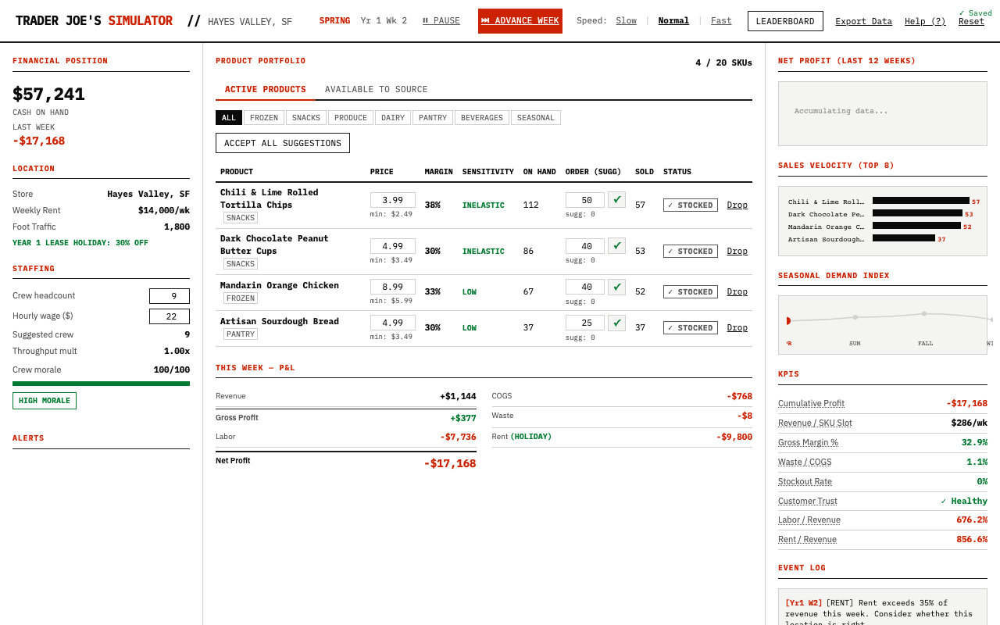

# Trader Joe's Simulator

A browser game where you run a grocery store week by week: choose products, set prices and orders, staff a crew, and ride a 52-week seasonal cycle. Play it at https://tjs-sim.vercel.app.

*Unofficial fan project, not affiliated with or endorsed by Trader Joe's. No real store data is used.*



## Highlights

- 8 locations and a catalog of 51 products across Frozen, Snacks, Produce, Dairy, Pantry, Beverages and Seasonal.
- Four 13-week seasons; foot traffic rises 15% in summer, 10% in fall and 5% in winter.
- Trends: in roughly one week in 11 with no active trend, one product's demand jumps 2.5×, then decays to 1.7× over 5 weeks.
- Prestige: reach $500,000 in cash or cumulative profit to open a new store with 20% of your cash (at least $15,000) and a perk.

## Run it

```bash
python3 -m http.server 8000   # then open http://localhost:8000
```

The leaderboard needs Supabase: copy `config.example.js` to `config.js` and add credentials. Without it the game plays normally.

## How it works

`game.js` holds the catalog and the weekly simulation; `ui.js` renders it; saves go to `localStorage`. You start with $75,000 and 20 product slots, rising to 30 at week 13 and 40 at week 27. Each week, unsold perishables cost 20% of their value, and perishable seasonal stock left when its window closes is written off in full. From week 8, stockouts permanently reduce demand. Throughput falls from 1.0× to as low as 0.35× with understaffing and low morale. The store goes bankrupt when cash drops below −$25,000 or inventory cannot cover half a week's labor and rent.

## Limitations

- The demand model is hand-tuned, not fitted to real sales data.
- There are no automated tests.

## License

MIT.
